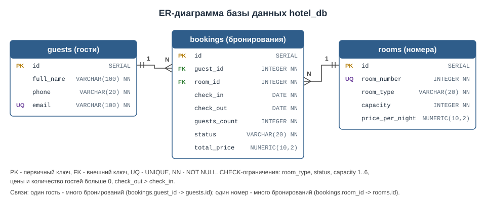
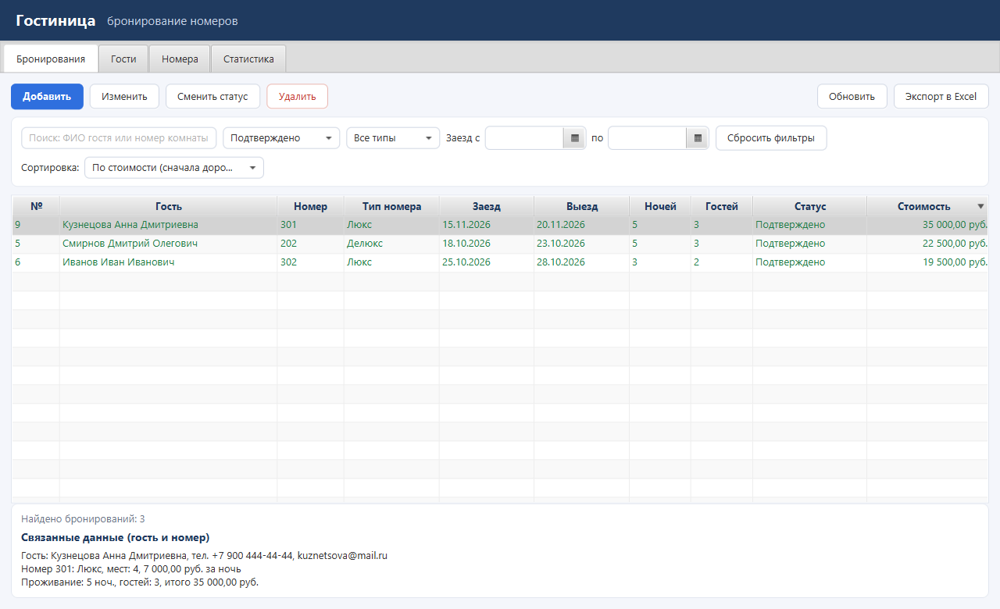
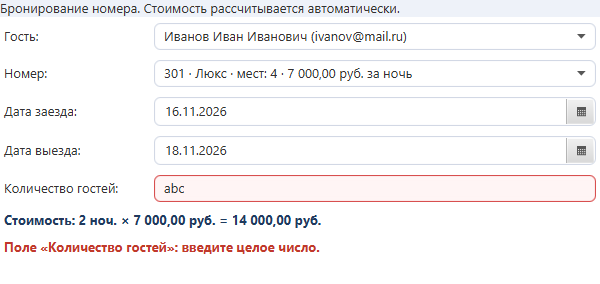
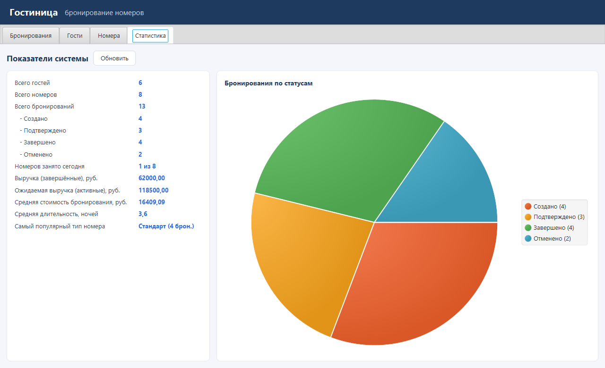

# Гостиница: бронирование номеров

Контрольные работы по дисциплине «Программирование корпоративных систем»:

- **КР №1** — консольная информационная система на Java + PostgreSQL (пакеты `ui`, `service`, `repository`, `model`);
- **КР №2** — настольное JavaFX-приложение (пакет `fx`) с тем же слоем service/repository и той же базой данных из КР №1.

Вариант:
- **Предметная область:** гостиница
- **Основная сущность:** бронирование номера
- **Связанные сущности:** гость, номер гостиницы

Архитектура (многослойная):

```
КР1:  Console UI (ui)                    \
                                          ->  Service (service)  ->  Repository / JDBC (repository)  ->  PostgreSQL
КР2:  FXML (view) + Controller (fx)      /
```

Быстрый старт: создать базу (раздел «Инструкция по запуску»), затем
- консоль (КР1): `mvn compile exec:java`;
- JavaFX (КР2): `mvn javafx:run` или в IntelliJ запустить `ru.mirea.hotel.fx.HotelFxLauncher`.

---

## Возможности (КР1, консоль)

Главное меню:

```
==================== ГОСТИНИЦА: БРОНИРОВАНИЕ НОМЕРОВ ====================
1. Гости
2. Номера
3. Бронирования
4. Поиск бронирований
5. Фильтрация бронирований
6. Сортировка бронирований
7. Статистика
8. Экспорт данных в Excel
9. Вывести таблицы базы данных
0. Выход
```

| Что | Как реализовано |
|---|---|
| CRUD | для гостей, номеров и бронирований: создать, показать все, найти по ID, изменить, удалить (с подтверждением) |
| Смена статуса | Создано → Подтверждено → Завершено, отмена из «Создано»/«Подтверждено» |
| Поиск (2 способа) | по части ФИО гостя; по номеру комнаты |
| Фильтрация (3 способа) | по статусу; по типу номера; по периоду дат заезда |
| Сортировка (3 способа) | по дате заезда; по стоимости (по убыванию); по ФИО гостя |
| Статистика (10+ показателей) | количество гостей/номеров/бронирований, разбивка по статусам, занятость номеров сегодня, выручка, ожидаемая выручка, средняя стоимость, средняя длительность, популярный тип номера |
| Экспорт | Excel `.xlsx`: листы «Гости», «Номера», «Бронирования» |
| Дополнительно | поиск свободных номеров на даты; при создании брони сразу показываются свободные номера |

## Технологии

- Java 21 (собирается и на более новых JDK)
- Maven
- PostgreSQL + JDBC-драйвер `org.postgresql:postgresql`
- Apache POI — экспорт в Excel
- JavaFX 21 (`javafx-controls`, `javafx-fxml`) — интерфейс КР2: FXML, CSS, TableView, ObservableList

---

## Структура проекта

```
hotel-project_pcs/
├── pom.xml                          # Maven: версия Java, зависимости, запуск
├── README.md                        # этот файл
├── hotel_export.xlsx                # пример экспортированного Excel-файла
├── sql/
│   └── init.sql                     # создание таблиц + тестовые данные
├── docs/
│   ├── er-diagram.svg               # ER-диаграмма базы данных
│   ├── er-diagram.png               # то же в PNG
│   └── kr2-*.png                    # снимки окон JavaFX-приложения
└── src/main/
    ├── resources/
    │   ├── database.properties      # адрес БД, логин, пароль (общие для КР1 и КР2)
    │   └── ru/mirea/hotel/fx/       # КР2: разметка окон и стили
    │       ├── main.fxml            # главное окно (вкладки)
    │       ├── bookings-tab.fxml    # вкладка «Бронирования»
    │       ├── guests-tab.fxml      # вкладка «Гости»
    │       ├── rooms-tab.fxml       # вкладка «Номера»
    │       ├── statistics-tab.fxml  # вкладка «Статистика»
    │       ├── booking-dialog.fxml  # форма бронирования
    │       ├── guest-dialog.fxml    # форма гостя
    │       ├── room-dialog.fxml     # форма номера
    │       └── app.css              # оформление
    └── java/ru/mirea/hotel/
        ├── Main.java                # КР1: точка входа консольной версии
        ├── fx/                      # КР2: JavaFX-приложение
        │   ├── HotelFxApp.java      # класс Application: проверка БД, загрузка main.fxml
        │   ├── HotelFxLauncher.java # запуск из IntelliJ
        │   ├── AppContext.java      # создаёт сервисы для контроллеров
        │   ├── controller/          # контроллеры окон и форм
        │   └── util/                # FxDialogs (диалоги, ошибки), FxCells (формат ячеек), FxAction
        ├── model/                   # классы предметной области
        │   ├── Guest.java           # гость
        │   ├── Room.java            # номер
        │   ├── Booking.java         # бронирование (основная сущность)
        │   ├── BookingStatus.java   # enum статусов + правило переходов
        │   └── RoomType.java        # enum типов номеров
        ├── repository/              # работа с БД (только здесь SQL)
        │   ├── CrudRepository.java  # интерфейс CRUD
        │   ├── GuestRepository.java
        │   ├── RoomRepository.java
        │   └── BookingRepository.java
        ├── service/                 # бизнес-логика и бизнес-правила
        │   ├── GuestService.java
        │   ├── RoomService.java
        │   └── BookingService.java  # + поиск, фильтры, сортировка, статистика
        ├── exception/               # собственные исключения
        │   ├── BusinessException.java
        │   └── EntityNotFoundException.java
        ├── util/
        │   ├── DatabaseManager.java # подключение к PostgreSQL
        │   └── ExcelExporter.java   # экспорт в .xlsx
        └── ui/                      # консольный интерфейс
            ├── BaseMenu.java        # абстрактное меню + общая обработка ошибок
            ├── MainMenu.java
            ├── GuestMenu.java
            ├── RoomMenu.java
            ├── BookingMenu.java
            ├── ConsoleInput.java    # безопасный ввод чисел, дат, строк
            ├── MenuAction.java      # функциональный интерфейс для действий меню
            └── TablePrinter.java    # вывод таблиц в консоль
```

---

## База данных



Три таблицы:

| Таблица | Что хранит | Ограничения |
|---|---|---|
| `guests` | гости | `PRIMARY KEY (id)`, `email UNIQUE`, все поля `NOT NULL` |
| `rooms` | номера гостиницы | `PRIMARY KEY (id)`, `room_number UNIQUE`, `CHECK` на тип, вместимость 1..6, цену > 0 |
| `bookings` | бронирования | `PRIMARY KEY (id)`, `FOREIGN KEY guest_id → guests.id`, `FOREIGN KEY room_id → rooms.id`, `CHECK` на статус, `check_out > check_in`, количество гостей > 0 |

Связи: **один гость — много бронирований**, **один номер — много бронирований**.

Тестовые данные (`sql/init.sql`): 6 гостей, 8 номеров трёх типов, 13 бронирований во всех четырёх статусах.

## Бизнес-правила

Правила проверяются в Java-коде в слое `service`, а часть из них дополнительно продублирована ограничениями в базе.

1. Нельзя указать несуществующего гостя или номер.
2. Дата выезда должна быть позже даты заезда, срок брони — не больше 30 ночей.
3. Нельзя бронировать задним числом: дата заезда не может быть раньше сегодняшней.
4. Количество гостей должно быть от 1 до вместимости номера.
5. Номер нельзя забронировать, если он уже занят на пересекающиеся даты (отменённые брони не учитываются).
6. Статусы меняются только по разрешённым переходам: Создано → Подтверждено/Отменено, Подтверждено → Завершено/Отменено.
7. Нельзя завершить бронирование, которое ещё не началось.
8. Изменять номер, даты и количество гостей можно только у активной брони (Создано/Подтверждено).
9. Стоимость считается автоматически: количество ночей × цена номера за ночь.
10. Email гостя и номер комнаты уникальны.
11. Нельзя удалить гостя или номер, у которых есть бронирования.
12. Нельзя сохранить гостя или номер с некорректными данными: пустое ФИО, неверный телефон или email, вместимость вне диапазона 1..6, цена ≤ 0.

## Обработка ошибок

Программа не завершается аварийно. Ошибки перехватываются в `BaseMenu.execute()`, после этого пользователь возвращается в меню:

| Ситуация | Что видит пользователь |
|---|---|
| текст вместо числа / неверная дата | `Ошибка: нужно ввести целое число.`, после чего вопрос повторяется |
| нет записи с таким ID | `Не найдено: Бронирование с ID 99 не найдено.` |
| нарушено бизнес-правило | `Ошибка: Номер 301 уже занят на даты ...` |
| нет связи с БД | `Ошибка подключения к базе данных: ...` |
| ошибка SQL-запроса | `Ошибка выполнения SQL-запроса: ...` |
| не удалось записать файл | `Ошибка работы с файлом: ...` |

---

## Инструкция по запуску

### 1. Что нужно установить

- **JDK 21** или новее — проверка: `java -version`
- **PostgreSQL** (любая актуальная версия) и pgAdmin (ставится вместе с PostgreSQL)
- **IntelliJ IDEA** (в ней уже есть Maven) **или** отдельно **Maven 3.9+** — проверка: `mvn -version`

### 2. Создать базу данных

**Через pgAdmin:**
1. Подключиться к серверу (пользователь `postgres`).
2. ПКМ по *Databases* → *Create* → *Database…* → имя `hotel_db` → *Save*.
3. ПКМ по `hotel_db` → *Query Tool* → открыть файл `sql/init.sql` → выполнить (F5).

**Или через командную строку** (если `psql` не найден, пишите полный путь, например `"C:\Program Files\PostgreSQL\18\bin\psql.exe"`):

```bash
psql -U postgres -c "CREATE DATABASE hotel_db"
```

```bash
psql -U postgres -d hotel_db -f sql/init.sql
```

> Скрипт `init.sql` удаляет таблицы и создаёт их заново с тестовыми данными.
> Его можно запускать повторно, чтобы вернуть базу в исходное состояние перед защитой.

### 3. Проверить настройки подключения

Файл `src/main/resources/database.properties`:

```properties
db.url=jdbc:postgresql://localhost:5432/hotel_db
db.user=postgres
db.password=password
```

Если у вас другой пароль от PostgreSQL, поменяйте его здесь. Java-код трогать не нужно.

### 4. Запустить программу

**Консольная версия (КР1):**
- IntelliJ IDEA: *File → Open…* → папка проекта (IDEA сама увидит `pom.xml` и скачает зависимости) →
  открыть `src/main/java/ru/mirea/hotel/Main.java` → зелёная кнопка ▶ рядом с `main`;
- или Maven в папке проекта:

```bash
mvn compile exec:java
```

При успешном запуске программа пишет `Подключение установлено: jdbc:postgresql://localhost:5432/hotel_db` и показывает главное меню.

**JavaFX-версия (КР2):**
- IntelliJ IDEA: открыть `src/main/java/ru/mirea/hotel/fx/HotelFxLauncher.java` → ▶ рядом с `main`
  (запускайте именно `HotelFxLauncher`: при прямом запуске `HotelFxApp` IDEA пишет «JavaFX runtime components are missing»);
- или Maven в папке проекта:

```bash
mvn javafx:run
```

> На Java 24 и новее в консоли могут появиться предупреждения `WARNING: ... sun.misc.Unsafe ...` от самой JavaFX — на работу они не влияют.

### Если русские буквы при вводе превращаются в «кракозябры»

Программа сама определяет кодировку консоли. Если всё же не получилось, задайте её вручную:
- в IntelliJ: *Run → Edit Configurations… → Modify options → Add VM options* → `-Dconsole.encoding=UTF-8`;
- в консоли Windows: сначала выполните `chcp 65001`, затем запустите программу.

---

## Экспорт в Excel

В консоли пункт меню **8** создаёт файл `hotel_export.xlsx` (имя можно поменять) с тремя листами: «Гости», «Номера», «Бронирования».
Полный путь к файлу программа выводит после экспорта. Пример готового файла лежит в корне проекта.

В JavaFX-версии кнопка **«Экспорт в Excel»** выгружает **текущий набор** бронирований (с учётом поиска и фильтров),
а место сохранения пользователь выбирает в окне `FileChooser`.

## Что сдаётся на защиту КР1

| Требование | Где находится |
|---|---|
| Исходный код Java-проекта | `src/main/java/ru/mirea/hotel/` |
| `pom.xml` | `pom.xml` |
| SQL-скрипт создания БД | `sql/init.sql` |
| ER-диаграмма | `docs/er-diagram.svg`, `docs/er-diagram.png` |
| Экспортированный Excel-файл | `hotel_export.xlsx` |
| Инструкция по запуску | этот README, раздел «Инструкция по запуску» |
| Рабочее консольное приложение | запуск по инструкции выше |

---

## КР2: JavaFX-приложение

Настольное приложение работает **с той же базой `hotel_db`** через JDBC: используются те же `database.properties`,
репозитории (DAO) и сервисы с бизнес-правилами, что и в КР1. Новые только интерфейс (FXML + CSS) и контроллеры.



### Окна и возможности

| Требование КР2 | Как реализовано |
|---|---|
| Главное окно | `main.fxml`: вкладки «Бронирования», «Гости», «Номера», «Статистика» |
| TableView + ObservableList | таблицы на всех вкладках, данные в `ObservableList`, после изменений таблица перечитывается из БД |
| Добавление / редактирование | формы в FXML (`*-dialog.fxml`) открываются как диалоги; при изменении — с текущими значениями; двойной клик по строке тоже открывает изменение |
| Удаление | только после подтверждения «Да/Нет» |
| Связанные сущности | гость и номер в форме выбираются из `ComboBox`, а не вводятся по ID; при выборе бронирования внизу видны данные гостя и номера; на вкладках «Гости» и «Номера» — бронирования выбранной записи |
| Поиск | по ФИО гостя и номеру комнаты, срабатывает при вводе |
| Фильтры | по статусу, типу номера, периоду заезда (можно сочетать) |
| Сортировка | клик по заголовку любого столбца + выбор «по дате заезда / по стоимости / по ФИО» |
| Валидация | понятное сообщение под формой, какое поле исправить; поле с неверным числом подсвечивается красным; правила из КР1 проверяет сервис |
| Статистика | вкладка «Статистика»: 10+ показателей и круговая диаграмма по статусам |
| Экспорт | `.xlsx` через `FileChooser` |
| FXML / CSS | 8 FXML-файлов, всё оформление в `app.css` |
| Ошибки | показываются в окне `Alert` понятным текстом, без stack trace; программа не падает |





### Слои КР2

| Слой | Где |
|---|---|
| View / FXML | `src/main/resources/ru/mirea/hotel/fx/*.fxml`, `app.css` |
| Controller | `ru.mirea.hotel.fx.controller.*` — принимают действия пользователя, SQL не содержат |
| Service | `ru.mirea.hotel.service.*` (из КР1) — бизнес-правила |
| Repository / DAO | `ru.mirea.hotel.repository.*` (из КР1) — SQL через JDBC |
| Database | PostgreSQL `hotel_db` (`sql/init.sql`) |

### Пример из архива (Docker)

По заданию КР2 нужно хотя бы раз развернуть готовую систему из архива `student-hub-suite.zip` (backend + PostgreSQL в Docker):

1. Установить и запустить **Docker Desktop**, дождаться состояния *Running*.
2. Распаковать архив, открыть PowerShell в папке `student-hub-suite-rebuilt` и выполнить:

```bash
powershell -ExecutionPolicy Bypass -File .\backend\start-compose.ps1
```

3. Проверить в браузере `http://localhost:8080/` и `http://localhost:8080/actuator/health` (должно быть `"status":"UP"`).
   Вход: `admin@example.org`, пароль — из задания (он же в `backend/.env`).
4. Запустить пример JavaFX-клиента: в папке `javafx-client` выполнить `mvn javafx:run`.
5. Остановить: `docker compose -f backend/docker-compose.yml down` (без `-v`, чтобы не удалить данные).

> В архиве файл `.env` лежит в папке `backend`, а PostgreSQL этого примера опубликован на порту `5433`,
> поэтому он не мешает нашей базе `hotel_db` на стандартном порту `5432`.

## Что сдаётся на защиту КР2

| Требование | Где находится |
|---|---|
| Исходный код JavaFX-приложения | `src/main/java/ru/mirea/hotel/fx/`, `src/main/resources/ru/mirea/hotel/fx/` |
| Рабочий проект Maven | `pom.xml` (`mvn javafx:run`) |
| Скрипты БД и тестовые данные | `sql/init.sql` |
| Демонстрация | запуск по инструкции выше |
