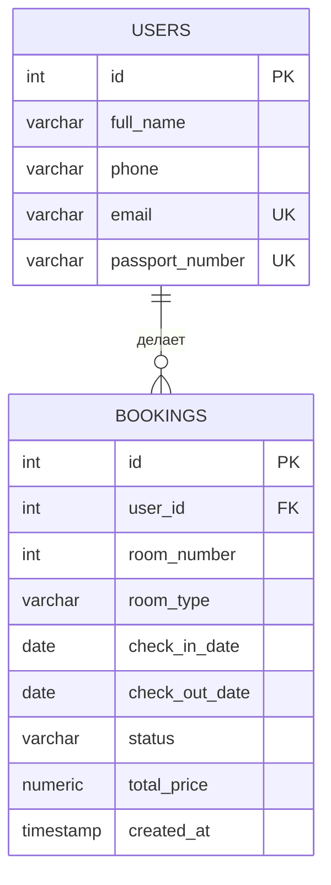

# Гостиница: Бронирование номеров (КР №1, Java + PostgreSQL)

Консольная информационная система для гостиницы.
Основная сущность — **Бронирование номера**, связанная сущность — **Гость (User)**.

Архитектура: `Console UI -> Service -> Repository / JDBC -> PostgreSQL`

## Структура проекта

```
hotel-project/
├── pom.xml                      # зависимости и сборка Maven
├── README.md                    # эта инструкция
├── sql/
│   └── init.sql                 # создание таблиц + тестовые данные
└── src/main/java/hotel/
    ├── Main.java                 # консольное меню (точка входа), проверка ввода по полям
    ├── model/
    │   ├── User.java              # гость гостиницы
    │   ├── Booking.java           # бронирование (основная сущность)
    │   ├── BookingStatus.java     # enum статусов бронирования
    │   └── RoomType.java          # enum типов номеров с ценой за ночь
    ├── repository/
    │   ├── CrudRepository.java    # обобщённый интерфейс CRUD
    │   ├── UserRepository.java    # SQL-запросы по гостям
    │   └── BookingRepository.java # SQL-запросы по бронированиям
    ├── service/
    │   ├── UserService.java       # бизнес-правила по гостям
    │   └── BookingService.java    # бизнес-правила, поиск, фильтры, сортировка, статистика
    ├── exception/
    │   ├── EntityNotFoundException.java
    │   └── BusinessException.java
    └── util/
        ├── DatabaseManager.java   # подключение к PostgreSQL
        ├── ExcelExporter.java     # экспорт данных в .xlsx (Apache POI)
        └── Validator.java         # проверка и нормализация ФИО, телефона, email, паспорта, номера комнаты, дат
```

## Что нужно установить

1. **JDK 17 или новее** — https://adoptium.net/
2. **Apache Maven** — https://maven.apache.org/download.cgi
3. **PostgreSQL** (сервер + консоль psql) — https://www.postgresql.org/download/

Проверить установку:
```
java -version
mvn -version
psql --version
```

> **Если в терминале VS Code команды не находятся, а в обычном PowerShell работают** —
> VS Code был запущен до установки JDK/Maven/PostgreSQL и помнит старую переменную PATH.
> Полностью закройте VS Code (все окна) и откройте заново. Быстрый вариант без перезапуска —
> выполнить в терминале VS Code:
> ```
> $env:Path = [Environment]::GetEnvironmentVariable('Path','Machine') + ';' + [Environment]::GetEnvironmentVariable('Path','User')
> ```

## Шаг 1. Создать базу данных

Откройте консоль `psql` (или pgAdmin) под пользователем postgres и выполните:

```
CREATE DATABASE hotel_db;
```

Затем примените SQL-скрипт с таблицами и тестовыми данными:

```
psql -U postgres -d hotel_db -f sql/init.sql
```

Скрипт создаст таблицы `users` и `bookings`, свяжет их внешним ключом
и заполнит 5 гостями и 12 бронированиями с разными статусами.

## Шаг 2. Настроить подключение к базе данных

Откройте файл:
```
src/main/java/hotel/util/DatabaseManager.java
```

и укажите свои значения (если они отличаются от значений по умолчанию):

```java
private static final String URL = "jdbc:postgresql://localhost:5432/hotel_db";
private static final String USER = "postgres";
private static final String PASSWORD = "password";
```

Параметры можно также переопределить при запуске, не меняя код:
```
java -Ddb.url=jdbc:postgresql://localhost:5432/hotel_db -Ddb.user=postgres -Ddb.password=secret -jar target/hotel-booking-system.jar
```

## Шаг 3. Собрать проект

В корне проекта (где лежит `pom.xml`) выполните:

```
mvn clean package
```

Maven скачает драйвер PostgreSQL и Apache POI, соберёт проект и создаст
файл `target/hotel-booking-system.jar`, в который уже упакованы все зависимости.

## Шаг 4. Запустить программу

```
java -jar target/hotel-booking-system.jar
```

Если подключение к базе данных настроено верно, вы увидите:
```
Подключение к базе данных установлено успешно.
```
и главное меню системы.

## Как пользоваться меню

```
1. Гости           - CRUD-операции над гостями
2. Бронирования    - CRUD-операции над бронированиями, изменение статуса, сортировка
3. Поиск           - поиск бронирований по имени гостя или номеру комнаты
4. Фильтрация      - фильтр по статусу или по типу номера
5. Статистика      - 7 показателей по системе
6. Экспорт данных  - выгрузка всех бронирований в bookings_export.xlsx
7. Таблицы БД      - вывод содержимого таблиц users и bookings
0. Выход
```

Даты вводятся в формате `гггг-мм-дд`, например `2026-10-01`.

## Реализованные бизнес-правила

**Гости** (класс `util/Validator.java`, вызывается из `UserService`):

| Поле | Правило | Пример верного значения | Как сохраняется |
|---|---|---|---|
| ФИО | 2–4 слова, только буквы (рус./лат.), внутри слова допустимы `-` и `'`, до 150 символов | `Салтыков-Щедрин Михаил` | лишние пробелы убираются |
| Телефон | российский номер: `+7` или `8` и ещё 10 цифр; допустимы пробелы, скобки, дефисы | `8 (916) 111-22-33` | `+7 916 111-22-33` |
| Email | `имя@домен.зона`, латиница, без `..`, зона от 2 букв, до 150 символов | `Petrov@Yandex.RU` | `petrov@yandex.ru` |
| Паспорт | 10 цифр: серия (4) + номер (6), пробелы допустимы, не из одних нулей | `4601 777888` | `4601777888` |

Email и номер паспорта должны быть уникальными (email — без учёта регистра).
Нельзя удалить гостя, у которого есть бронирования.

**Бронирования** (`BookingService` + `Validator`):

1. Нельзя создать бронирование для несуществующего гостя (ID гостя > 0).
2. Номер комнаты трёхзначный: этаж (1–9) + номер на этаже (01–99), т.е. 101–999, кроме 100, 200, ...
3. Дата выезда должна быть позже даты заезда; проживание — не больше 30 ночей.
4. Дата заезда новой брони — не в прошлом и не дальше чем через 365 дней.
5. Номер нельзя забронировать, если он уже занят на пересекающиеся даты
   (бронированием, которое не отменено). День выезда одного гостя может быть днём заезда другого.
6. Изменять можно только бронирования в статусах `CREATED` и `CONFIRMED`.
7. Переход между статусами бронирования разрешён только по строго
   заданной схеме: `CREATED -> CONFIRMED/CANCELLED -> CHECKED_IN -> CHECKED_OUT`.

В консольном меню каждое поле проверяется сразу при вводе: при ошибке программа
объясняет, что не так, и просит ввести именно это поле ещё раз.

## Тестирование

Код был скомпилирован и проверен в изолированном окружении:
- модульные тесты бизнес-вычислений (расчёт стоимости, количество ночей, пересечение дат);
- интеграционные тесты (23 сценария) на реальной базе PostgreSQL: создание/чтение/
  изменение/удаление гостей и бронирований, все бизнес-правила, поиск, фильтрация,
  сортировка, статистика — все тесты пройдены успешно;
- сквозной прогон консольного меню `Main.java` с эмулированным вводом пользователя
  (создание гостя, бронирования, поиск, фильтр, статистика, экспорт, вывод таблиц,
  корректный выход без аварийного завершения).

## ER-диаграмма базы данных



## Что представить на защите

1. Исходный код Java-проекта (эта папка).
2. Файл `pom.xml`.
3. SQL-скрипт `sql/init.sql`.
4. ER-диаграмму базы данных (две таблицы: `users` 1—ко—многим `bookings`
   через `bookings.user_id -> users.id`).
5. Экспортированный Excel-файл (`bookings_export.xlsx`, создаётся пунктом меню 6).
6. Эту инструкцию по запуску.
7. Рабочее консольное приложение (`java -jar target/hotel-booking-system.jar`).
